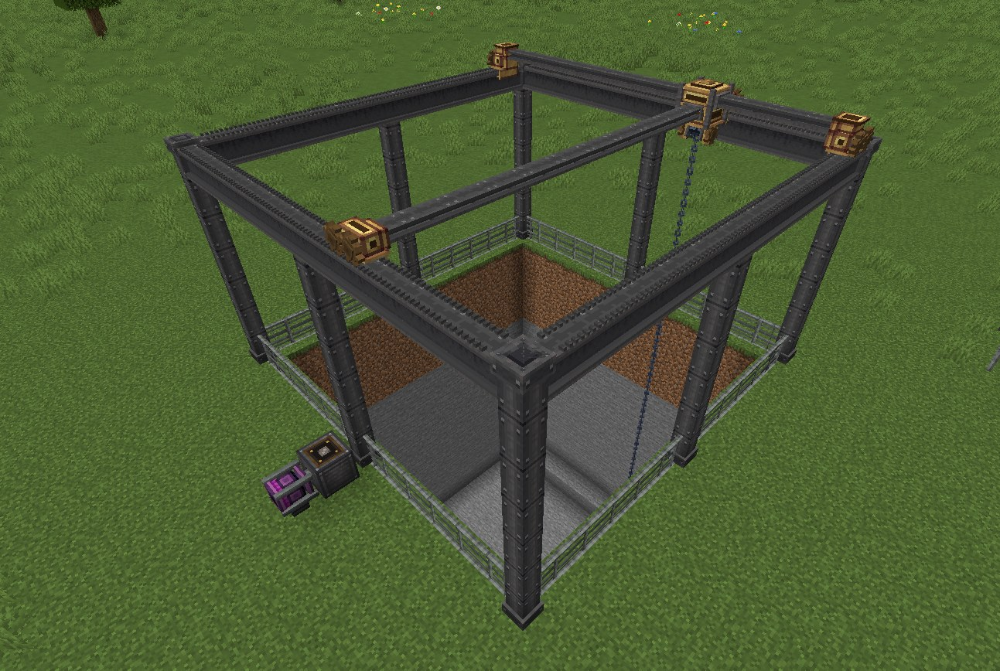
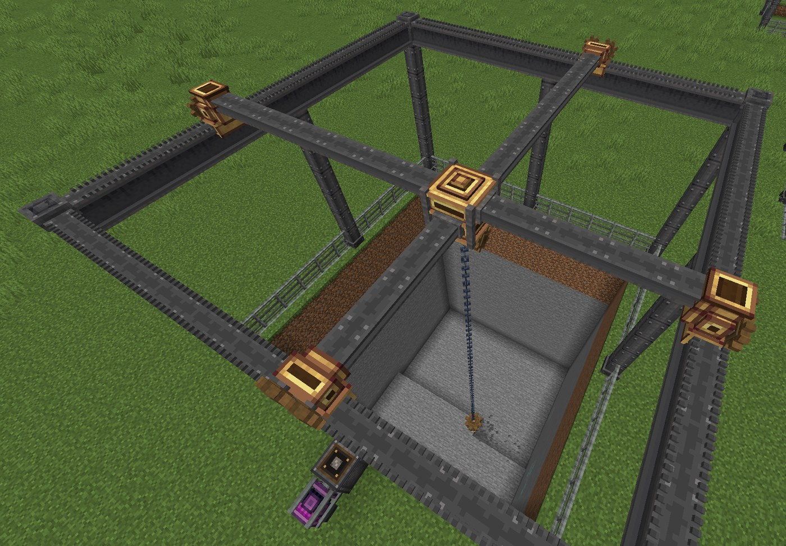
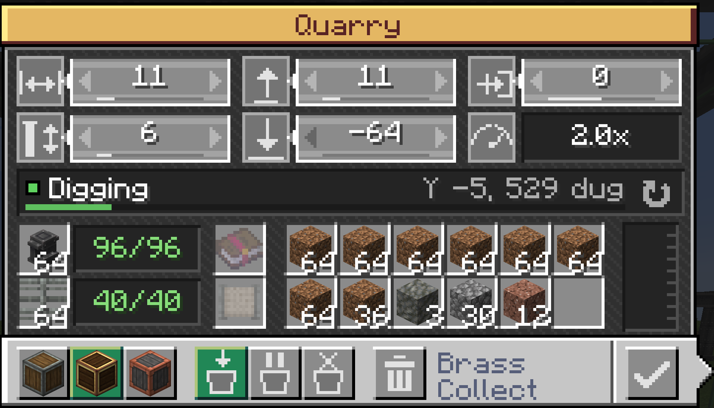

# Create: Tem Quarry

Create addon for Minecraft 1.20.1 on Fabric (Create Fabric 6.0.8.1).

A rotation-powered gantry quarry. It builds a frame of pillars and beams (Create metal girders) over an area, runs a cross on carriages along the beams, and lowers a drill on a chain from the middle of the cross to dig the area out layer by layer.

Building is a show of its own: each pillar drops into place whole with a heavy clang and a puff of dust, then the beams between the pillars, then the fence runs around the ring block by block. Then the gantry is assembled: one girder cross bar drops onto the beams with its two carriages, then the other; both slide to the centre; the hub closes on them from a lower and an upper half; the winch rolls down out of the hub while the drill appears on the ground under it; the chain runs down to the drill and snaps on, and the drill is hoisted up. Pillars stand at the corners and along the sides, at most 8 blocks apart, spread evenly.

Breaking the quarry brings the gantry down: the cross bars snap in the middle, everything tumbles to the ground and sinks away.

## Using it

1. Place the **Quarry** facing the area you want to dig. The area starts right in front of it.
2. Right-click it to open the settings. The window is in Create's style; its header takes the colour of the quarry's style.

   

   - Number fields, top row: **width** (left-right) and **length** (away from the quarry) of the dug area, and **offset**, which moves the area left (-) or right (+) of the quarry
   - Second row: **frame height** (the shortest column; on uneven ground the other columns grow so the tops stay level), **dig down to** (lowest Y level), and the working speed
   - To change a number: click it and type (Enter to confirm), drag across it like a slider, scroll over it, or click the arrows at its ends (hold to repeat). Shift takes bigger steps. Hover the icons for what each field is.
   - Footer buttons: **style** (Andesite, Brass or Copper casing), **fluids** (Collect: void what doesn't fit; Fill & Wait; Void), and **remove frame when broken** (see below). Style only changes the look of the machinery: the carriages, the hub where the cross bars meet, the drill housing and the quarry's gearbox face. The frame is always girder.
   - The status strip shows what the quarry is doing, with a progress bar (frame pieces while building, depth while digging). Hover it for details. The arrow at its right end sends the drill over the whole area again from the top. The tank gauge at the right shows the stored fluid when hovered.

   While the UI is open, or while you look at the quarry, the area is outlined in the world (orange while the new size is pending). Size, offset and height apply when you close the UI (Escape or the tick button); the frame is rebuilt and digging starts over. Style, depth and fluid mode apply right away.
3. Feed the frame materials into their two slots, by hand or with funnels or chutes: **metal girders** for columns and beams (one per piece) and **andesite bars** for the fence (one per piece). The quarry takes them into its stock as the frame needs them, so two slots are enough for any size, and funnels can keep feeding it. The counter next to each slot shows supplied / needed pieces (green once there's enough); hover it for details. Anything beyond what the frame needs comes back out into the slot, and taking a frame down (resizing) returns its pieces to the stock for the next one.

4. Power it with a shaft on the back at medium speed (30 RPM) or faster. It draws 32 su per RPM, and its speed scales with RPM (32 RPM is 1x, up to 8x).
5. Take the output out with funnels, chutes or hoppers, and fluids with pipes.

Optional slots:

- **Enchantment**: a Fortune or Silk Touch book (or tool). Its enchantments apply to everything dug.
- **Void filter**: drops matching this item or Create filter are destroyed.

Fluids: before digging each layer, the quarry swaps every fluid in that layer for a temporary barrier block (Create's andesite scaffolding) and pumps the sources into its tank (64 buckets; pull it out with pipes). Fluids outside the area that would flow into the pit get walled off with barriers, and waterlogged blocks on the pit walls lose their water. Over water, the fence stands on the surface (quarries from older versions that put it on the pond floor move it up when loaded). Taking sources one at a time wouldn't work, because Minecraft's infinite water rule would keep refilling the pit.

The frame stands above any hill inside the area, so the gantry never cuts through the ground. Columns and beams break blocks in their way and send the drops to the output; the fence never breaks anything. If a column or beam goes missing, the quarry pauses and puts it back.

Containers and other block entities are dug like any block, and their contents go into the output. Blocks in the `create_tem_quarry:quarry_ignored` block tag (empty by default) are left alone.

Blocks that turn up in the pit after the drill went past (placed by someone, sand falling in) are noticed and dug first, always from the top of their column down. A finished quarry keeps watching its area too, and wakes up to dig anything new. The drill moves like a gantry crane: it rises until it clears everything on the way, travels across, then lowers onto the next block, so it never cuts through anything. A block put right into its way (onto the chain, or next to the drill) is knocked loose into the output.

The drill hurts mobs and players it touches, like Create's mechanical drill. The cross can be walked on: invisible solid entities follow the bars and the hub (it doesn't carry you along when it moves).

Breaking the quarry: the quarry item it drops keeps its settings and its frame stock (shown in the item's tooltip), so nothing has to be carried around as loose girders and bars. With **remove frame when broken** on, the frame comes down too and goes into that stock. With it off (the default, from the `dismantleOnBreak` server option), the frame stays standing: place a quarry facing it (with the frame's near side right in front of it) and it takes the frame over at its size, for free, and reassembles its gantry. Frame and fence blocks broken by hand drop their material. In creative mode breaking drops nothing, so the stock is lost.

Recipe: metal girders in the corners, a rope pulley on top, cogwheels on the sides, andesite casing in the middle and a mechanical drill at the bottom.

## Config

Both configs can be edited in game: Mod Menu, or Create's config screen under "other mods".

- `config/create_tem_quarry-client.toml`: visual variants. These are read every frame, so you can compare them live:
  - `cogStyle`: Create cogwheel, Create large cogwheel, all-metal styled cog, or none
  - `cogsPerCarriage`: 0-2
  - `carriageStyle`: low bogie, or a housing that wraps around the beam
  - `beamDrive`: rack and pinion, leadscrew shafts along the beams, or both
  - `crossStyle`: Create girder (default, dark grey), iron rod, industrial iron, or the style's metal. The two bars of the cross run at different heights and pass over each other at the hub.
  - `ropeStyle`: chain (default), rope, hose or steel cable
  - `drillStyle`: large auger (default: a spiral auger bit under a housing with a cog turning on top), Create drill head, or the small auger
  - `drillSpin`: how fast the bit turns compared to the input shaft (default 3x); it spins up and down smoothly
  - `drillShake`: the drill shudders while it cuts
  - `winchCogs`, `drillParticles`, `areaPreview`, `renderDistance`
- `config/create_tem_quarry-server.toml` (or `saves/<world>/serverconfig/` if Forge Config API Port is set to per-world server configs): gameplay settings: stress impact, speed requirement, size limits, frame and fence materials, fence type (the fence material's bars, girder railing, or none), pillar spacing, barrier look (Create andesite / brass / copper scaffolding or matching the quarry style, vanilla scaffolding, framed glass), build speed (`buildStepTicks` and `buildTicksPerPiece` per pillar or beam span, `fenceStepTicks` per fence block, `gantryStepTicks` per gantry assembly stage), dig speed, tank size, fluid sealing, drill damage, allowed enchantments, and more.

## Commands

For operators, mostly useful for testing:

| Command | What it does |
| --- | --- |
| `/quarry configure <pos> <width> <length> <offset> <frameHeight> [style]` | Applies settings like the UI does |
| `/quarry supply <pos>` | Stocks everything the frame needs and fills both material slots |
| `/quarry open <pos>` | Opens the UI |
| `/quarry info <pos>` | Prints status, layer, area and drill position |
| `/quarry restart <pos>` | Digs again from the top, keeping the frame |
| `/quarry rebuild <pos>` | Takes the frame down and builds it again with the current config |

## Development

### Requirements

- Java 17 (`brew install openjdk@17`)
- VS Code with the recommended Java extensions, or Zed with the Java extension
- Python 3 with Pillow, only to regenerate assets

### Workflow

| Command | What it does |
| --- | --- |
| `./gradlew runClient` | Dev client with Create, JEI, and Mod Menu (no login needed) |
| `./gradlew runServer` | Dev server |
| `./gradlew build` | Builds `build/libs/create-tem-quarry-<version>.jar` |
| `./gradlew installToPack` | Builds and replaces the jar in `pack_mods_dir` |
| `./gradlew genSources` | Decompiles Minecraft so the editor can show its source |
| `./gradlew vscode` | Regenerates `.vscode/launch.json` (run and debug the client from VS Code) |
| `python3 tools/gen_assets.py` | Regenerates block models, gantry part models, blockstates and the gantry part atlases (needs Pillow and the Create jar, like gen_textures.py) |
| `python3 tools/gen_textures.py` | Regenerates the quarry block faces, the winch's chain coil, and the UI sheet (window, header colours, icons) |

For `installToPack`, copy `local.properties.example` to `local.properties` and set `pack_mods_dir` to a Prism instance's `minecraft/mods` folder.

Dev-only mods live in `build.gradle` as `modLocalRuntime` dependencies. Extra jars can also go in `run/mods/`.

### Layout

- `quarry/`: the quarry block, its block entity (frame building, digging, fluids, storage), area planning, menu and settings
- `frame/`: frame and fence blocks the quarry places
- `client/`: gantry renderer, partial models, UI screen, area outline
- `config/`: server (gameplay) and client (visual) configs
- `tools/`: asset generators. The frame reuses Create's girder textures. The styled machinery parts (carriages, hub, drill motor) are templates with texture variables plus one small child model per style; their faces come from a generated per-style part atlas (`textures/block/gantry_parts_<style>.png`) where Create's casing and metal textures are 9-sliced to each face's exact size, so every part has borders on its edges and normal 16-texel resolution instead of squashed or cut-off block textures.

## License

MIT, see [LICENSE](LICENSE). The frame and machinery textures are built from Create's own textures (MIT).
